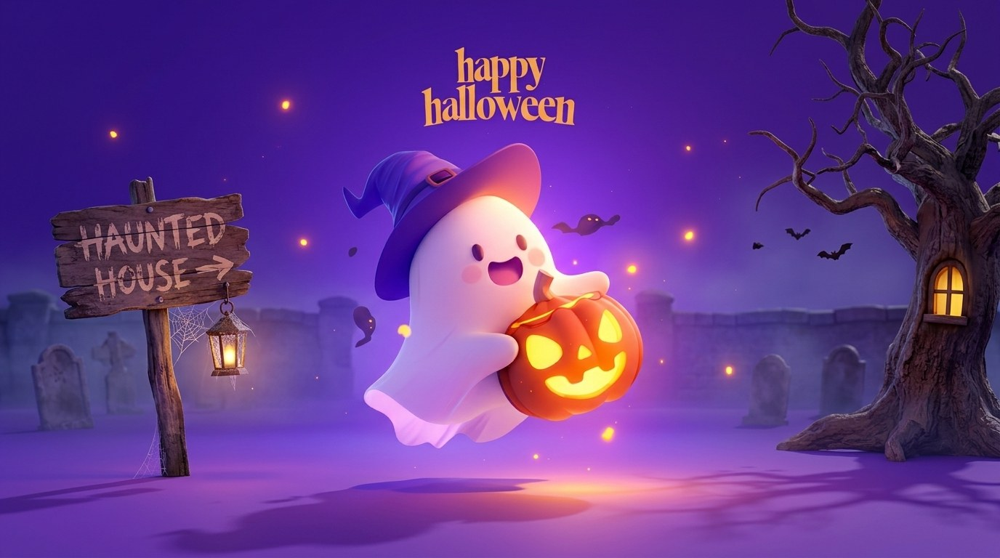

# 👻 haunt

> A 3D ghost with a lantern that drifts across dark, rainy water — and thinks with a local AI model. Everything runs on your machine. Nothing leaves it.



---

## ✨ Features

- **3D ghost** rendered in real-time with Three.js — cloth sway, lantern pendulum, rain ripples, and dynamic lighting
- **Local AI brain** — powered by [Ollama](https://ollama.com) + Gemma (or any model you have); whisper to it and it whispers back
- **Haunting mode** — 11 escalating horror events fire every ~30 seconds: fake system monitor, idle watch, terminal takeover, footsteps across the water, a second lantern, the ghost staring off-screen, and more
- **Ofrenda mode** — Día de los Muertos remembrance mode; the ghost listens with warmth and can speak with the echo of someone you name
- **Ambient audio** — synthesized rain, drone, heartbeat and whispers, plus looping background music; both start automatically
- **Zero dependencies** — stdlib Python only for the server; all assets ship in `./static`

---

## 🚀 Quick Start

```bash
# 1. Pull a model (Gemma is used by default, any tag works)
ollama pull gemma3

# 2. Start the server
python haunt_web.py

# 3. Open in your browser
#    http://127.0.0.1:8787
```

Then **swipe up** (or press Enter / arrow keys) on the intro page to wake the ghost.

---

## 🎮 Controls

| Action | How |
|---|---|
| Steer the ghost | WASD / arrow keys, or **click the water** |
| Hurry | Hold **Shift** |
| Push the lantern | Brush or click it |
| Poke the ghost | Click it |
| Chat | Type in the input bar at the bottom |
| Leave a haunting | **Esc** |
| Toggle haunting | **Haunting: off** button in the header |
| Switch modes | **Ofrenda mode** button |
| Mute music | **Music: on** button |
| Mute ambient sound | **Sound: on** button |

Left alone for ~12 seconds the ghost wanders on its own.

---

## 👻 Haunting Mode

Enable it with the **Haunting: off** button. Events fire every ~30 seconds.

**Every event has a build-up:** the rain stops, the lantern gutters, the ghost stills and slowly turns to face you, a heartbeat speeds up — then sudden silence.

**Eleven events (escalating):**

1. 🖥️ Fake system monitor scan
2. 💤 Idle watch — catches you if you stop moving
3. 🪟 Active-window awareness — "Don't switch."
4. 💻 Fake terminal with an unknown process
5. 📁 Fake filesystem scan
6. 📷 Camera permission moment *(camera off the instant it turns on; nothing recorded)*
7. 🌐 Localhost horror console
8. 👣 Footsteps rippling across calm water
9. 🏮 A second pale lantern drifts toward the ghost
10. 👁️ The ghost stares at something off-screen
11. 🕐 The ghost tells you the exact time

After each event, the ghost comments on what you did (stayed, ran, said no to the camera...). Add `?debug` to the URL to see the real countdown.

> Everything is simulated. No files are read, no commands run, and the camera is switched off the instant it turns on.

---

## 🕯️ Ofrenda Mode

Switch to this mode for Día de los Muertos remembrance. The ghost listens gently, asks about the person you want to remember (their name, favourite foods, songs, stories), and can speak with their warmth as an echo made from your own memories.

Safety-first: if you say anything that sounds unsafe, the ghost steps out of character and encourages you to reach out to someone who can help.

---

## 🎵 Audio

| | |
|---|---|
| **Background music** | `static/music.mp3` — loops quietly, starts on your first touch of the intro page, drains during dread build-ups |
| **Ambient sound** | Synthesized rain, low drone, heartbeat and breathy whispers — all browser-generated, no samples |
| **Music credit** | *"Nebula Voyager"* by OneCinematicStudio — verify your right to use before publishing |

---

## 🛠️ How It Works

### Server (`haunt_web.py`)
- Pure Python stdlib — no `pip install` needed
- Serves `./static` as a static file server with byte-range support (needed for Safari audio)
- Proxies `/api/chat` to Ollama on `localhost:11434` with a streaming NDJSON response
- Picks Gemma automatically (sorted first); falls back to whatever model is available

### Frontend
| File | Role |
|---|---|
| `static/index.html` | Shell, intro/swipe page, header buttons |
| `static/app.js` | Three.js scene — ghost mesh, water shader, ripples, lantern light, AI chat |
| `static/music.js` | Background music player with ducking |
| `static/haunting.js` | 11 horror events, dread build-up, synthesized audio engine |
| `static/ghost.bin` | Ghost mesh (decimated from 1.9M → 110k triangles, lantern marked per vertex) |
| `static/ghost.json` | Mesh metadata |
| `static/tex_color.jpg` | Albedo texture |
| `static/tex_normal.jpg` | Normal map |
| `static/tex_orm.jpg` | Occlusion / roughness / metalness map |

### Shaders (in `src/main.js`)
- **Cloth sway** — vertex shader animates the ghost body with layered sine waves
- **Lantern pendulum** — vertex-shader physics on the lantern chain
- **Water** — rain ripple rings + lantern caustic light breaking up on them

---

## 🔧 Rebuild the JS (optional)

The bundled `static/app.js` is already included. To rebuild from source:

```bash
npm i three esbuild
npx esbuild src/main.js --bundle --minify --format=iife --outfile=static/app.js
```

---

## 📋 Requirements

- Python 3.8+
- [Ollama](https://ollama.com) running locally
- Any Ollama model pulled (Gemma recommended: `ollama pull gemma3`)
- A modern browser (Chrome, Firefox, Safari, Edge)

---

## 📄 License

MIT — see [LICENSE](LICENSE)

---

## 🙏 Credits

- Ghost model, shaders & app — original work
- Three.js — [threejs.org](https://threejs.org)
- AI inference — [Ollama](https://ollama.com)
- Background music — *"Nebula Voyager"* by OneCinematicStudio
